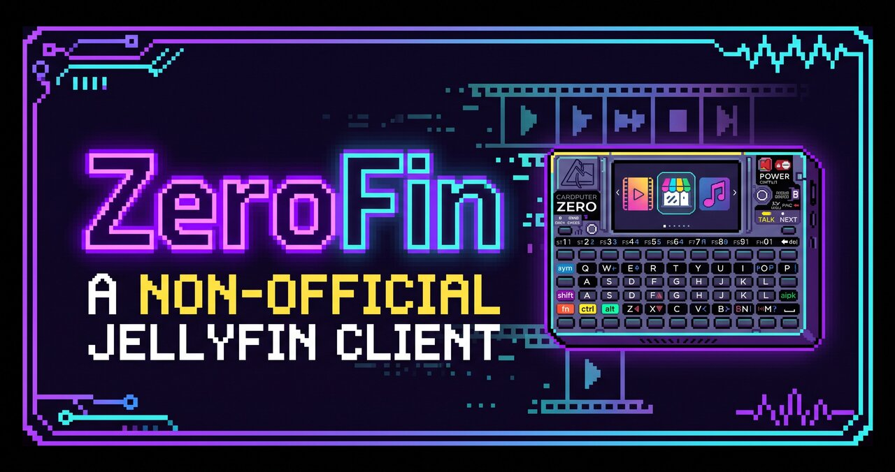

# ZeroFin

<p align="center">
  
</p>

A video client for [Jellyfin](https://jellyfin.org) on the M5Stack Cardputer Zero (320x170 screen, 46-key keyboard).
Not an official Jellyfin app.

Status: in development. Login, browsing with posters, search and the player work.

## Build and test on a computer

```sh
cmake -S . -B build -DZEROFIN_BUILD_APP=OFF   # library and unit tests only
cmake --build build && ctest --test-dir build
```

## Simulator (macOS, SDL2)

```sh
brew install cmake sdl2 freetype
cmake -S . -B build-app -DZEROFIN_BUILD_TESTS=OFF
cmake --build build-app
ZEROFIN_DEMO=1 ./build-app/src/app/zerofin     # a fake server, no network needed
```

Keys in the simulator: arrows, Enter, Esc, Tab, Backspace, typing. F1-F5 are the media keys.

## Home screen and posters

The home screen starts with a row of tiles (one per library, then Search and Settings). Under it are rows of
posters: Keep watching, Next up, and Recent in each movie, TV or collection library. Up and Down change the row.
Left and Right move inside a row. Enter opens the item. The library, series and season lists and Search show the
posters in a grid of four columns.

Posters are small JPEG files (64x96). One download runs at a time, on its own worker. They are kept in
`$ZEROFIN_HOME/cache/images` (default `~/.config/ZeroFin/cache/images`, up to 50 MB, the oldest files go first).
Delete that folder at any time. A title with no poster shows a grey card with its first letter.

## Player keys

Media keys (fn+Q, fn+W, fn+E, fn+S, fn+D) always act. Any other key opens the controls. F, X, Z and C also work as
arrows in every screen without a text field (home, lists, detail, settings). The other letters below work in the
player only. Screens with a text field (address, search, password) type the letters as text.

| Key | Action |
|---|---|
| F / X / Z / C | up / down / left / right (move between the control icons) |
| Q | play / pause |
| S / D | volume down / up |
| A | mute |
| W / E | back 15 s / forward 15 s (act at once, controls can stay hidden) |
| fn+W / fn+E | previous / next episode |
| Enter | press the focused icon |
| Tab | audio and subtitle menu (when the controls are shown) |
| Esc | hide the controls, then leave the player |

## Device (Cardputer Zero, native build)

```sh
cmake -S . -B build -DUSE_DESKTOP=OFF -DZEROFIN_BUILD_TESTS=OFF
cmake --build build -j4
./build/src/app/zerofin
```

Needs `cmake`, `g++`, `git` and `libfreetype-dev`. The first build compiles LVGL and takes about 20 minutes.

## Install on the Cardputer Zero (.deb)

```sh
tools/build-deb.sh            # needs Docker on an arm64 host; writes dist/zerofin_<version>_arm64.deb
scp dist/zerofin_*.deb user@cp0:
ssh user@cp0 sudo apt install ./zerofin_*.deb
```

The package puts the program in `/usr/share/APPLaunch/bin`, so ZeroFin appears in the launcher. It depends on
`libmpv2`, `libfreetype6` and `curl`. GitHub Actions builds the unit tests and the `.deb` on every push
(`.github/workflows/ci.yml`). `release-please` keeps `version.txt` and attaches the `.deb` to each release.

## Developer settings (environment variables)

| Variable | Effect |
|---|---|
| `ZEROFIN_DEMO=1` | Use the built-in fake server. Quick Connect approves itself after a few polls. Password login: `demo` / `demo`. |
| `ZEROFIN_HOME=DIR` | Keep the settings in DIR instead of `~/.config/ZeroFin`. |
| `ZEROFIN_TRANSPORT=cli` | Run `/usr/bin/curl` for HTTP. The default on macOS, which blocks LAN access for locally built programs. |
| `ZEROFIN_HEADLESS=1` | Simulator without a window (SDL dummy driver). |
| `ZEROFIN_SCRIPT=...` | Play scripted keys: `wait:MS;idle:MS;key:NAME;text:STR;shot:NAME;quit`. With `ZEROFIN_SHOT_DIR`, `shot:` saves a PPM picture. |
| `ZEROFIN_KEYLOG=1` | Device: print the raw key codes. |
| `ZEROFIN_ASSETS=DIR` | Where to find `fonts/`. |
| `ZEROFIN_DEMO_DURATION=SECONDS` | Demo player: length of the fake video (default 5760). |
| `ZEROFIN_GRAB_KEYBOARD=1` | Device, for SSH test runs: take the keyboard from the launcher. Off by default, so the OS still sees the long Esc press. |
| `ZEROFIN_FB=PATH` | Framebuffer device (default `/dev/fb_lcd`, a link to `/dev/fb0`). |

`$ZEROFIN_HOME/profile.json` can override the playback numbers (direct play limit, transcode size and bitrate).
See `src/jellyfin/device_profile.h` for the keys.

## Layout

| Folder | Content |
|---|---|
| `src/jellyfin/` | Jellyfin client library, with no UI code |
| `src/storage/` | Settings file (`config.json`, mode 0600) and the poster cache |
| `src/ui_core/` | UI logic without LVGL: key map, list and grid cursors, card text, request queue, text editing, formatting |
| `src/app/` | The LVGL application: screens, widgets, platform code |
| `spike/` | The playback spike (libmpv into an LVGL canvas) |
| `tools/` | `jf_probe`: a live check of the client against a real server. `gen-demo-posters.sh` makes the demo posters (needs ffmpeg) |
| `tests/` | Unit tests (doctest, run with CTest) |

## License

MIT. See `LICENSE` and `THIRD_PARTY_NOTICES.md`.
